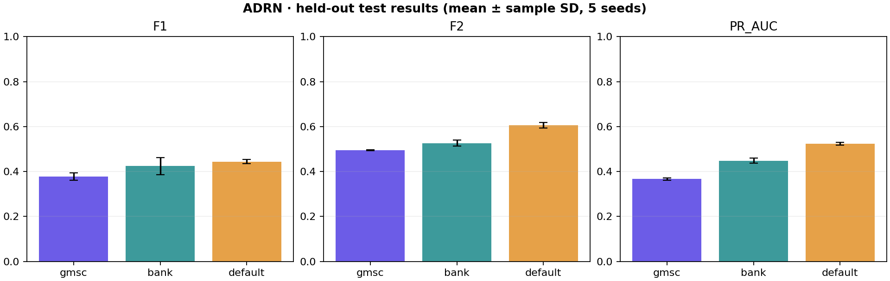
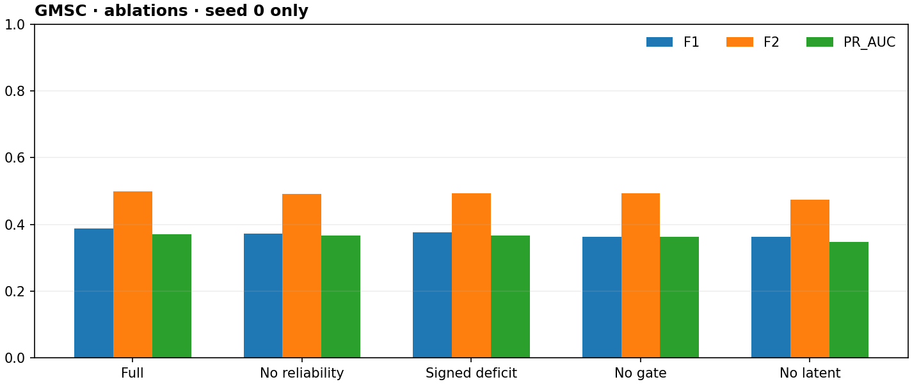
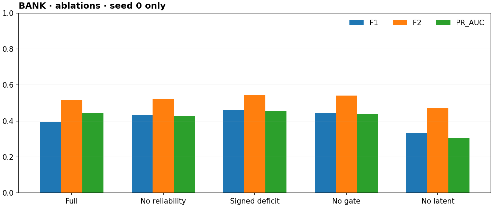
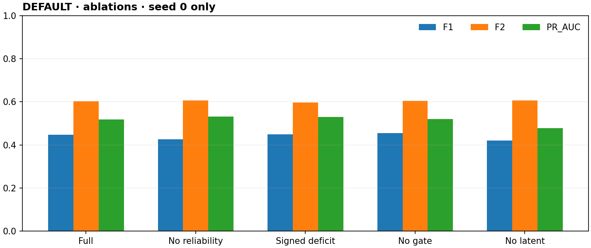

# ADRN

**Overlap-Aware Deep Probabilistic Reconstruction Network**  
面向不平衡金融数据分类的重叠感知深度概率重构网络：根据用户提供的论文独立实现与实验。

> 本项目是独立复现，不是论文作者官方代码。本文实验基于实际训练和独立测试；未使用论文报告值填充运行结果。论文部分超参数与预处理细节未披露，本实现的设置见下文，实验结果不保证与原文相同。

## 方法

编码器采用 `Linear → GELU → Linear → LayerNorm`，利用两类可学习各向同性高斯混合基元构建观测概率；随后依次应用：

- **RPDB**：基于 Bhattacharyya 系数计算跨类冲突与类内冗余，形成可靠度加权结构概率。
- **MPSDR**：提取结构概率高于观测概率的非负差值，作为少数类支持缺口。
- **OARG**：利用两类基元责任度和跨类重叠构造局部门控，调节补偿幅度。

训练执行编码器监督预训练、按真实类别 KMeans 初始化基元、端到端联合优化；验证集 PR-AUC（Average Precision）选择检查点，并在验证集最大化 F2 确定阈值，再在独立测试集上评估。预处理仅在训练集拟合，`duration`、`ID` 和标签均不作为输入。

## 实际实验结果

下表是本仓库运行得到的独立测试集结果，固定一次 8:1:1 分层划分，种子 0–4 独立初始化，报告均值 ± 样本标准差；PR-AUC 按 Average Precision 计算。

| 数据集 | Precision | Recall | F1 | F2 | ROC-AUC | PR-AUC |
|---|---:|---:|---:|---:|---:|---:|
| GMSC | 0.2708 ± 0.0220 | 0.6273 ± 0.0262 | 0.3773 ± 0.0159 | 0.4952 ± 0.0021 | 0.8337 ± 0.0012 | 0.3665 ± 0.0053 |
| Bank | 0.3247 ± 0.0579 | 0.6355 ± 0.0572 | 0.4244 ± 0.0387 | 0.5268 ± 0.0127 | 0.7925 ± 0.0037 | 0.4481 ± 0.0115 |
| Default | 0.3079 ± 0.0092 | 0.8015 ± 0.0302 | 0.4446 ± 0.0087 | 0.6065 ± 0.0121 | 0.7505 ± 0.0078 | 0.5243 ± 0.0062 |



以下每张图展示种子 0 的测试集 PR/ROC 曲线、验证集训练曲线和按验证集阈值计算的测试集混淆矩阵：


## 消融实验

根据论文结构分别设置 `w/o Reliability`、`w/o Deficit`（取消 ReLU，使用有符号残差）、`w/o Gate` 和 `w/o Latent`（跳过编码器及其预训练）。以下结果为种子 0 的单次实际运行，不能用于统计显著性结论。Bank 和 Default 的部分消融指标高于完整模型，本次实验不支持“各模块均提升全部指标”的结论。

| 数据集 | 方案 | F1 | F2 | PR-AUC |
|---|---|---:|---:|---:|
| GMSC | 完整模型 | 0.3868 | 0.4988 | 0.3709 |
| GMSC | w/o Reliability | 0.3731 | 0.4914 | 0.3665 |
| GMSC | w/o Deficit | 0.3759 | 0.4930 | 0.3668 |
| GMSC | w/o Gate | 0.3635 | 0.4932 | 0.3629 |
| GMSC | w/o Latent | 0.3623 | 0.4749 | 0.3469 |
| Bank | 完整模型 | 0.3943 | 0.5155 | 0.4429 |
| Bank | w/o Reliability | 0.4334 | 0.5239 | 0.4268 |
| Bank | w/o Deficit | 0.4622 | 0.5446 | 0.4577 |
| Bank | w/o Gate | 0.4427 | 0.5411 | 0.4392 |
| Bank | w/o Latent | 0.3348 | 0.4705 | 0.3055 |
| Default | 完整模型 | 0.4475 | 0.6018 | 0.5190 |
| Default | w/o Reliability | 0.4254 | 0.6072 | 0.5316 |
| Default | w/o Deficit | 0.4491 | 0.5969 | 0.5302 |
| Default | w/o Gate | 0.4547 | 0.6053 | 0.5203 |
| Default | w/o Latent | 0.4195 | 0.6069 | 0.4776 |





## 实验约定与差异

- 三组数据分别为 [Give Me Some Credit](https://www.kaggle.com/competitions/GiveMeSomeCredit/data)、[UCI Bank Marketing](https://archive.ics.uci.edu/dataset/222/bank+marketing) 和 [UCI Default of Credit Card Clients](https://archive.ics.uci.edu/dataset/350/default+of+credit+card+clients)。Bank 剔除 `duration`，Default 剔除 `ID`。本实现分别得到 10、50、33 个特征；Default 与论文表格的 29 维不同，原因包括编码方案未完全明确。
- 划分随机种子 42；数值缺失用训练集中位数填补及标准化，类别缺失用训练集众数填补并独热编码。Default 的 SEX、EDUCATION、MARRIAGE 按类别编码。GMSC 实验使用 Kaggle 数据的公开副本；数据文件未提交至仓库。
- 本次使用 CPU、Adam、学习率 0.001、批大小 512、隐层 64、潜在维数 16、每类 4 个基元、采样指数 β=0.5、预训练 3 轮、联合训练 6 轮、梯度裁剪 5。论文未完整给出搜索空间和每项训练配置，本实验使用明确固定的近似配置，**尚未执行论文所述 TPE 搜索**。
- 五次运行共享同一划分，标准差反映随机初始化和采样波动，不代表跨数据划分的泛化波动。论文其他七种横向基线、K 敏感性、不平衡率压力实验及统计显著性检验尚未完整复现。
- 四种消融结构均已实现；结果若以单次训练呈现，只能作为运行验证，不能代替论文的五次消融和显著性分析。

## 运行

```bash
python -m venv .venv
# Windows: .venv\\Scripts\\activate
# Linux/macOS:
source .venv/bin/activate
pip install -r requirements.txt
python -m experiments.download_uci
# 从 Kaggle 下载 GMSC 的 cs-training.csv 放入 data/raw/
python -m unittest discover -s tests -v
python -m experiments.run --seeds 0 1 2 3 4
python -m experiments.ablation --seeds 0
python -m experiments.plot_summary
```

运行产物写入 `results/`、`figures/` 和本地 `checkpoints/`。检查点目前只包含模型权重和参数，不包含预处理器，不应直接作为完整推理包使用。原始数据与检查点默认不上传。
