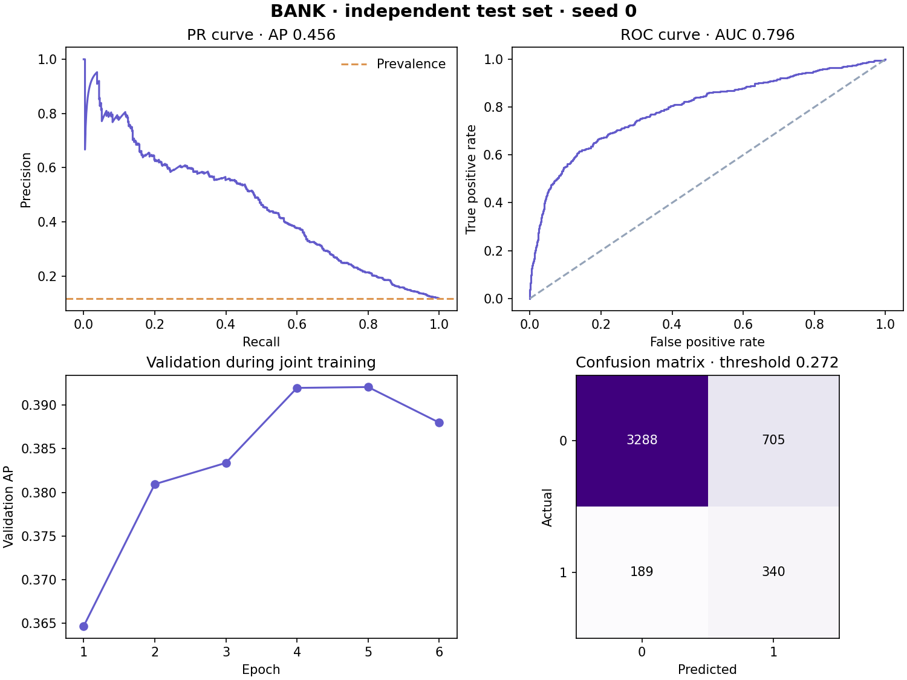
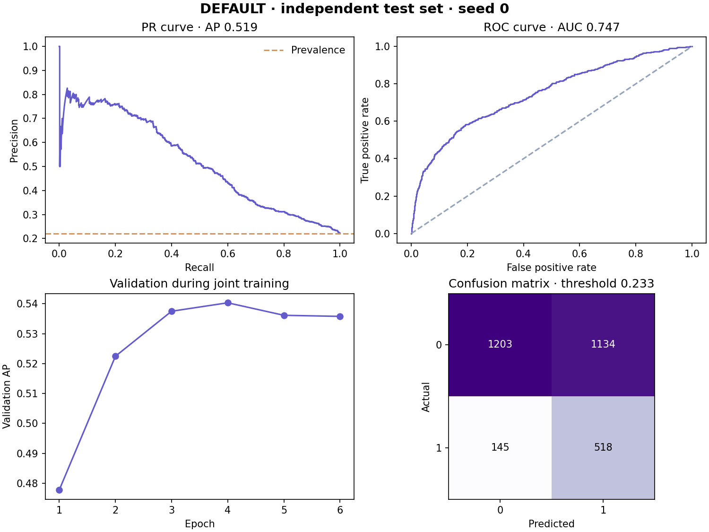
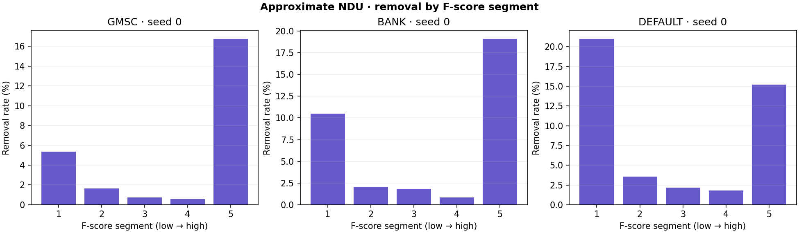
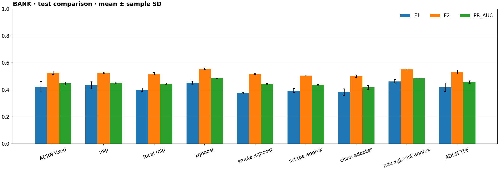
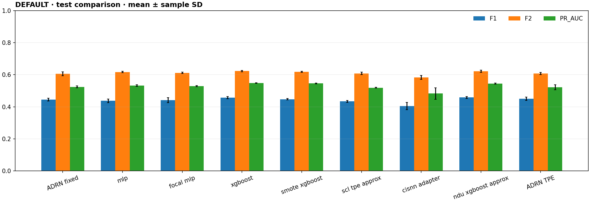
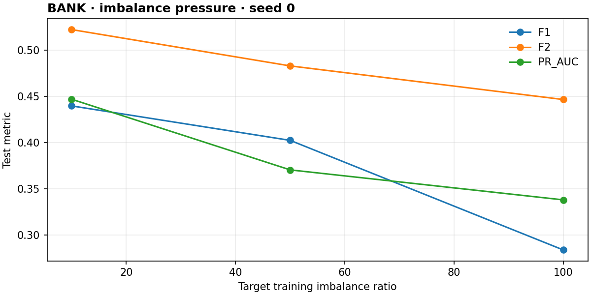
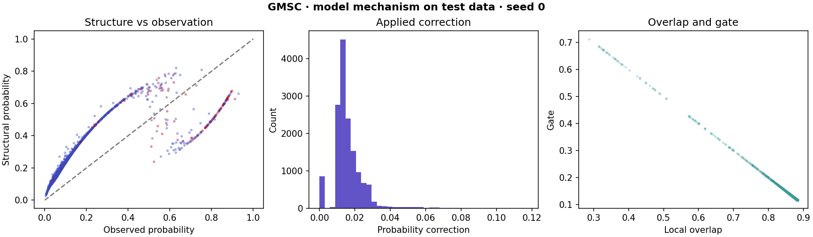
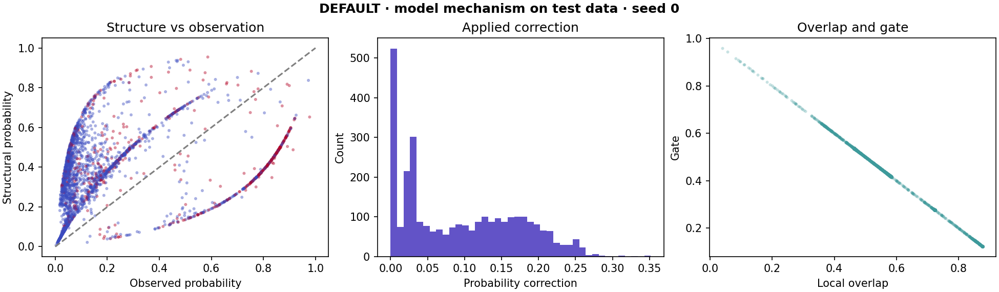
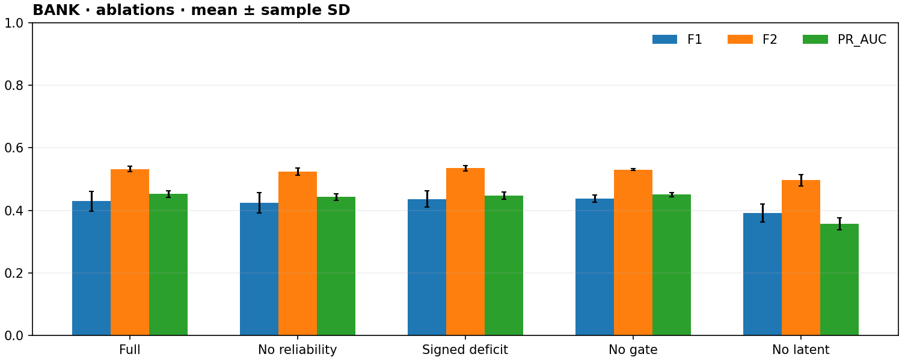

# ADRN

**Overlap-Aware Deep Probabilistic Reconstruction Network**  
面向不平衡金融数据分类的重叠感知深度概率重构网络：根据用户提供的论文独立实现与实验。

> 本项目是独立复现，不是论文作者官方代码。本文实验基于实际训练和独立测试；未使用论文报告值填充运行结果。论文部分超参数与预处理细节未披露，本实现的设置见下文，实验结果不保证与原文相同。

## 方法

编码器采用 `Linear → GELU → Linear → LayerNorm`，利用两类可学习各向同性高斯混合基元构建观测概率；随后依次应用：

- **RPDB**：基于 Bhattacharyya 系数计算跨类冲突与类内冗余，形成可靠度加权结构概率。
- **MPSDR**：提取结构概率高于观测概率的非负差值，作为少数类支持缺口。
- **OARG**：利用两类基元责任度和跨类重叠构造局部门控，调节补偿幅度。

训练执行编码器监督预训练、按真实类别 KMeans 初始化基元、端到端联合优化；验证集 PR-AUC（Average Precision）选择检查点，并在验证集最大化 F2 确定阈值，再在独立测试集上评估。预处理仅在训练集拟合，`duration`、`ID` 和标签均不作为输入。

## 实际实验结果

下表是本仓库运行得到的独立测试集结果，固定一次 8:1:1 分层划分，种子 0–4 独立初始化，报告均值 ± 样本标准差；PR-AUC 按 Average Precision 计算。

| 数据集 | Precision | Recall | F1 | F2 | ROC-AUC | PR-AUC |
|---|---:|---:|---:|---:|---:|---:|
| GMSC | 0.2708 ± 0.0220 | 0.6273 ± 0.0262 | 0.3773 ± 0.0159 | 0.4952 ± 0.0021 | 0.8337 ± 0.0012 | 0.3665 ± 0.0053 |
| Bank | 0.3247 ± 0.0579 | 0.6355 ± 0.0572 | 0.4244 ± 0.0387 | 0.5268 ± 0.0127 | 0.7925 ± 0.0037 | 0.4481 ± 0.0115 |
| Default | 0.3079 ± 0.0092 | 0.8015 ± 0.0302 | 0.4446 ± 0.0087 | 0.6065 ± 0.0121 | 0.7505 ± 0.0078 | 0.5243 ± 0.0062 |


以下每张图展示种子 0 的测试集 PR/ROC 曲线、验证集训练曲线和按验证集阈值计算的测试集混淆矩阵：





## TPE 搜索与横向基线

每个数据集进行 5 次候选搜索（前 2 次为 TPE 启动采样），搜索空间为隐层 `{32,64}`、潜在维数 `{8,16}`、每类基元数 `{4,8}`、学习率 `[0.0005,0.002]`（对数采样）和采样指数 β `[0.25,0.75]`。只按验证集 AP 选配置，再对固定配置执行五次独立初始化并在测试集评估；搜索过程及各次结果存于 `results/*_tpe.json`。这是便于复现的小规模搜索，不能视为原文未公开搜索范围的等价实现。

| 数据集 | TPE 后 F1 | TPE 后 F2 | TPE 后 PR-AUC |
|---|---:|---:|---:|
| GMSC | 0.3673 ± 0.0128 | 0.4941 ± 0.0035 | 0.3690 ± 0.0030 |
| Bank | 0.4193 ± 0.0310 | 0.5332 ± 0.0148 | 0.4572 ± 0.0111 |
| Default | 0.4497 ± 0.0105 | 0.6074 ± 0.0064 | 0.5220 ± 0.0164 |

另以相同划分、验证集 F2 阈值和五次运行比较下列基线；这是自行指定配置的独立实现，无法保证与论文基线配置完全相同。MLP 和 Focal MLP 的隐藏层为 64/16、均使用 β=0.5 抽样，Focal 设置 α=0.25、γ=2；XGBoost 为 150 棵树、最大深度 4；SMOTE 仅用于训练集，但对独热编码列也做插值，可能产生非整数的类别表示。

| 数据集 | 基线 | F1 | F2 | PR-AUC |
|---|---|---:|---:|---:|
| GMSC | MLP | 0.3794 ± 0.0061 | 0.4967 ± 0.0023 | 0.3685 ± 0.0017 |
| GMSC | Focal MLP | 0.3791 ± 0.0123 | 0.4926 ± 0.0030 | 0.3664 ± 0.0020 |
| GMSC | XGBoost | 0.4152 ± 0.0072 | 0.5241 ± 0.0044 | 0.4066 ± 0.0019 |
| GMSC | SMOTE + XGBoost | 0.3632 ± 0.0058 | 0.5067 ± 0.0035 | 0.3738 ± 0.0023 |
| GMSC | SCL-TPE 近似 | 0.3706 ± 0.0158 | 0.4846 ± 0.0013 | 0.3570 ± 0.0049 |
| GMSC | CISNN 适配 | 0.3378 ± 0.0208 | 0.4601 ± 0.0141 | 0.3275 ± 0.0111 |
| GMSC | NDU + XGBoost 近似 | 0.4108 ± 0.0028 | 0.5257 ± 0.0031 | 0.4060 ± 0.0014 |
| BANK | MLP | 0.4344 ± 0.0260 | 0.5254 ± 0.0055 | 0.4510 ± 0.0070 |
| BANK | Focal MLP | 0.4004 ± 0.0128 | 0.5192 ± 0.0089 | 0.4453 ± 0.0045 |
| BANK | XGBoost | 0.4530 ± 0.0114 | 0.5561 ± 0.0060 | 0.4867 ± 0.0019 |
| BANK | SMOTE + XGBoost | 0.3759 ± 0.0065 | 0.5174 ± 0.0031 | 0.4442 ± 0.0026 |
| BANK | SCL-TPE 近似 | 0.3947 ± 0.0152 | 0.5066 ± 0.0028 | 0.4371 ± 0.0022 |
| BANK | CISNN 适配 | 0.3828 ± 0.0245 | 0.5014 ± 0.0099 | 0.4180 ± 0.0144 |
| BANK | NDU + XGBoost 近似 | 0.4631 ± 0.0124 | 0.5514 ± 0.0041 | 0.4850 ± 0.0027 |
| DEFAULT | MLP | 0.4371 ± 0.0120 | 0.6172 ± 0.0043 | 0.5330 ± 0.0054 |
| DEFAULT | Focal MLP | 0.4415 ± 0.0158 | 0.6116 ± 0.0046 | 0.5290 ± 0.0036 |
| DEFAULT | XGBoost | 0.4571 ± 0.0072 | 0.6226 ± 0.0045 | 0.5483 ± 0.0021 |
| DEFAULT | SMOTE + XGBoost | 0.4473 ± 0.0042 | 0.6183 ± 0.0035 | 0.5455 ± 0.0029 |
| DEFAULT | SCL-TPE 近似 | 0.4337 ± 0.0060 | 0.6083 ± 0.0084 | 0.5187 ± 0.0026 |
| DEFAULT | CISNN 适配 | 0.4040 ± 0.0228 | 0.5829 ± 0.0120 | 0.4826 ± 0.0358 |
| DEFAULT | NDU + XGBoost 近似 | 0.4581 ± 0.0066 | 0.6214 ± 0.0065 | 0.5446 ± 0.0038 |

**SCL-TPE 近似实现：**参考原方法的[公开预印本](https://arxiv.org/abs/2210.10824)，先通过同标签监督对比损失训练编码器，再冻结编码器训练三层分类器；TPE 在 `[0.05,1.0]` 内搜索温度，并以验证集 ROC-AUC 选取。为明确可运行，数值特征两次视图使用标准差 0.05 的高斯噪声，独热类别列不加噪；每个对比训练轮最多使用 16000 个训练样本、对比训练 2 轮、分类器训练 4 轮，每组搜索 5 次，后以 5 个种子评估。预印本中的增强细节和原 ADRN 论文中的基线配置不完全公开，故本项是**独立近似基线，不声称为作者原版 SCL-TPE**。搜索和每次运行结果见 `results/*_scl_tpe.json`。

**CISNN 适配：**已找到[作者公开代码](https://github.com/Huangza123/CIS/blob/0d1313db2cdeaa0deb713b7d27665d45abc6f7e8/train_CIS.py)。本项目独立实现其代码中可核对的设置：多数类 KMeans 分 15 簇，以 `exp(-到少数类最近距离) + 0.9 × (1 - 中心点负类概率)` 选 4 簇，保留全部少数类，并从其余多数类中随机抽取选中多数类样本数一半；网络为 10 隐藏单元、双输出 ReLU，分别计算正负类交叉熵后相加。由于作者示例反复评估测试集，本适配改为验证集 AP 选检查点、验证集 F2 选阈值，60 轮训练而非原始示例的 10000 轮；数值和验证流程属于适配结果，不能标为原代码原封不动的复现。作者仓库未发现许可文件，因此未将其源码复制进本仓库。完整配置及结果见 `results/*_cisnn.json`。

**NDU + XGBoost 近似：**依据 Sun 等的 [NDU 论文](https://doi.org/10.1016/j.neucom.2024.128492)，在训练集计算 `K=floor(sqrt(N/IR))`、跨类邻域重叠及其多数类扩展区域，计算同类邻居比例并在重叠样本上拟合 5 分量全协方差 GMM，以 `0.8 × LNN + 0.2 × 密度` 得到 F-factor；每段以 `1 - mean(F)/max(F)` 计算删除率，删除多数类后训练 XGBoost，**不额外使用 SMOTE**。

论文对 Algorithm 1 的 `ComputeThreshold`、`Segment` 和删除函数 `RS` 没有给出可直接执行的具体实现，本项目因此采用 **按 F-factor 排序后的 5 个等样本数分段、各段均匀随机删除**；密度以 `exp(logpdf - max(logpdf))` 映射至 `(0,1]`。为处理最大 12 万训练样本，邻域搜索使用 FAISS HNSW **近似邻居**，而非精确 KNN。它是明确标注的论文引导近似，并非作者原始 NDU 代码的严格复现。几何结构和 GMM 每个数据集只拟合一次，五次运行改变删除与 XGBoost 的随机种子；因此标准差不包含近邻索引和 GMM 的拟合波动，HNSW 多线程构建的细微非确定性也可能带来数值变化。

| 数据集 | 近邻 K | 扩展重叠多数类样本 | 每次删除多数类 | F1 | F2 | PR-AUC |
|---|---:|---:|---:|---:|---:|---:|
| GMSC | 92 | 106833 | 5360 | 0.4108 ± 0.0028 | 0.5257 ± 0.0031 | 0.4060 ± 0.0014 |
| BANK | 69 | 31638 | 2170 | 0.4631 ± 0.0124 | 0.5514 ± 0.0041 | 0.4850 ± 0.0027 |
| DEFAULT | 82 | 18686 | 1632 | 0.4581 ± 0.0066 | 0.6214 ± 0.0065 | 0.5446 ± 0.0038 |



具体实验参数、每次结果与分段删除率见 `results/*_ndu_approx.json`；执行 `python -m experiments.ndu_xgboost` 后可重新生成结果，`python -m experiments.plot_ndu` 重绘图形。

本次 XGBoost 在三组数据的 F1、F2、PR-AUC 上均高于本次固定配置的 ADRN；因此本次结果不支持 ADRN 在这些条件下全面优于该基线。图中同时保留固定配置和 TPE 配置，TPE 配置并未根据测试集结果选择。





## Bank 基元数量及不平衡率实验

以下为种子 0 的单次测试。K 敏感性使用 4、6、8、10、12，预训练 4 轮、联合训练 12 轮，其余配置与原固定配置相同；不平衡率实验仅对训练集少数类无放回抽样，保留训练集多数类，目标 IR 为 10、50、100，预处理在抽样后的训练集重新拟合，验证集和测试集划分保持不变，K=8。由于只运行一次且训练轮数与主实验不同，仅用于观察趋势。




完整数值及实际类别比例见 `results/sensitivity.json`。

## 重构机制分析

以下为固定配置、种子 0 模型在独立测试集的内部量，不用于选择模型。散点图显示观测概率与结构概率，直方图显示最终补偿，右图显示局部重叠与门控的对应关系；散点为固定随机种子抽取的至多 2500 个样本。

| 数据集 | 测试正类数 | 正类中存在正缺口的样本 | 平均门控值 | 平均概率补偿 |
|---|---:|---:|---:|---:|
| GMSC | 1003 | 607 | 0.1887 | 0.0162 |
| Bank | 529 | 422 | 0.5891 | 0.1275 |
| Default | 663 | 381 | 0.4133 | 0.0938 |





运行 `python -m experiments.mechanism` 需要先运行主实验生成本地种子 0 检查点。

## 五次消融实验

依据论文设置四种结构变体，沿用固定配置、相同划分及种子 0–4；下表为测试集均值 ± 样本标准差。`w/o Deficit` 使用有符号残差，`w/o Latent` 跳过编码器预训练。各方案在同一固定测试集上重复训练，本次结果中部分消融均值高于完整模型，不能据此声称各模块都带来提升。

| 数据集 | 方案 | F1 | F2 | PR-AUC |
|---|---|---:|---:|---:|
| GMSC | 完整模型 | 0.3773 ± 0.0159 | 0.4952 ± 0.0021 | 0.3665 ± 0.0053 |
| GMSC | w/o Reliability | 0.3754 ± 0.0101 | 0.4934 ± 0.0040 | 0.3641 ± 0.0019 |
| GMSC | w/o Deficit | 0.3681 ± 0.0124 | 0.4915 ± 0.0018 | 0.3623 ± 0.0079 |
| GMSC | w/o Gate | 0.3691 ± 0.0112 | 0.4937 ± 0.0019 | 0.3638 ± 0.0016 |
| GMSC | w/o Latent | 0.3666 ± 0.0105 | 0.4778 ± 0.0052 | 0.3489 ± 0.0051 |
| BANK | 完整模型 | 0.4244 ± 0.0387 | 0.5268 ± 0.0127 | 0.4481 ± 0.0115 |
| BANK | w/o Reliability | 0.4300 ± 0.0344 | 0.5274 ± 0.0100 | 0.4426 ± 0.0103 |
| BANK | w/o Deficit | 0.4347 ± 0.0258 | 0.5341 ± 0.0088 | 0.4492 ± 0.0080 |
| BANK | w/o Gate | 0.4285 ± 0.0310 | 0.5330 ± 0.0062 | 0.4481 ± 0.0088 |
| BANK | w/o Latent | 0.3889 ± 0.0323 | 0.4916 ± 0.0172 | 0.3473 ± 0.0241 |
| DEFAULT | 完整模型 | 0.4446 ± 0.0087 | 0.6065 ± 0.0121 | 0.5243 ± 0.0062 |
| DEFAULT | w/o Reliability | 0.4468 ± 0.0132 | 0.6148 ± 0.0052 | 0.5280 ± 0.0045 |
| DEFAULT | w/o Deficit | 0.4480 ± 0.0145 | 0.6090 ± 0.0115 | 0.5275 ± 0.0038 |
| DEFAULT | w/o Gate | 0.4479 ± 0.0096 | 0.6083 ± 0.0061 | 0.5241 ± 0.0055 |
| DEFAULT | w/o Latent | 0.4261 ± 0.0054 | 0.6082 ± 0.0056 | 0.4789 ± 0.0009 |





## Welch 检验与多重比较

固定配置 ADRN 与七类基线（含 SCL-TPE、CISNN 和 NDU 的近似或适配）、四种消融的五次测试 F1、F2、PR-AUC 分别采用双侧 Welch t 检验；横向对比形成 **63 项**、消融形成 **36 项**比较，分别进行 Benjamini–Hochberg 调整，全部原始 p 值和调整值见 `results/significance.json`。横向 63 项中 22 项、消融 36 项中 6 项调整后 p < 0.05；显著性本身不表明 ADRN 占优，方向需结合实际均值判断。

**统计限制：**五次结果共享同一训练、验证和测试划分，且每组仅 5 次，Welch 检验不能反映跨划分波动，其独立性与正态性假设也较难充分验证；这些 p 值只作为固定划分下的探索结果，不应外推为稳健的统计结论。论文与本项目横向比较均含 7 项方法、63 项检验，但其中 3 项为独立近似或适配，具体训练配置也不同，因此与论文结果不等价。

## 实验约定与差异

- 三组数据分别为 [Give Me Some Credit](https://www.kaggle.com/competitions/GiveMeSomeCredit/data)、[UCI Bank Marketing](https://archive.ics.uci.edu/dataset/222/bank+marketing) 和 [UCI Default of Credit Card Clients](https://archive.ics.uci.edu/dataset/350/default+of+credit+card+clients)。Bank 剔除 `duration`，Default 剔除 `ID`。本实现分别得到 10、50、33 个特征；Default 与论文表格的 29 维不同，原因包括编码方案未完全明确。
- 划分随机种子 42；数值缺失用训练集中位数填补及标准化，类别缺失用训练集众数填补并独热编码。Default 的 SEX、EDUCATION、MARRIAGE 按类别编码。GMSC 实验使用 Kaggle 数据的公开副本；数据文件未提交至仓库。
- 本次使用 CPU、Adam、学习率 0.001、批大小 512、隐层 64、潜在维数 16、每类 4 个基元、采样指数 β=0.5、预训练 3 轮、联合训练 6 轮、梯度裁剪 5。论文未完整给出搜索空间和每项训练配置，本实验使用明确固定的近似配置，并补充了 5 次候选的 TPE 搜索；这一小规模搜索不等同于论文未公开的完整搜索配置。
- 五次运行共享同一划分，标准差反映随机初始化和采样波动，不代表跨数据划分的泛化波动。另行实现四类常规横向基线、SCL-TPE 和 NDU 近似、CISNN 适配，以及 Bank 单次 K/不平衡率实验。
- 四种消融已各完成五次；检验使用本项目固定配置与七项基线，其中 SCL-TPE、CISNN 与 NDU 为近似或适配实现。

## 运行

```bash
python -m venv .venv
# Windows: .venv\\Scripts\\activate
# Linux/macOS:
source .venv/bin/activate
pip install -r requirements.txt
python -m experiments.download_uci
# 从 Kaggle 下载 GMSC 的 cs-training.csv 放入 data/raw/
python -m unittest discover -s tests -v
python -m experiments.run --seeds 0 1 2 3 4
python -m experiments.tune --trials 5 --seeds 0 1 2 3 4
python -m experiments.baselines --seeds 0 1 2 3 4
python -m experiments.scl_tpe --trials 5 --seeds 0 1 2 3 4
python -m experiments.cisnn --epochs 60 --seeds 0 1 2 3 4
python -m experiments.ndu_xgboost --seeds 0 1 2 3 4
python -m experiments.plot_ndu
python -m experiments.sensitivity
python -m experiments.ablation --seeds 0 1 2 3 4
python -m experiments.plot_summary
python -m experiments.plot_extra
python -m experiments.plot_ablation_means
python -m experiments.mechanism
python -m experiments.significance
```

运行产物写入 `results/`、`figures/` 和本地 `checkpoints/`。检查点目前只包含模型权重和参数，不包含预处理器，不应直接作为完整推理包使用。原始数据与检查点默认不上传。
